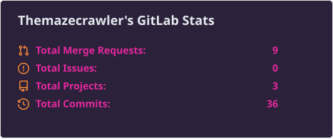
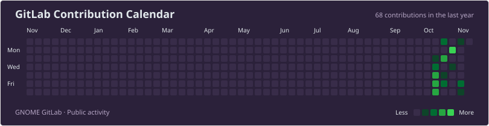

---

## About Me

I'm a software developer interested in building useful software, exploring new technologies, and contributing to open-source projects.

## Tech Stack

---
### Connect With Me

  
  

---

## Projects & Repositories

**Here’s an up-to-date list of my primary repositories and what they entail:**

- [**StimaSense**](https://github.com/Themazecrawler/StimaSense)  
  *Language: TypeScript | Public*  
  _Description:_ A comprehensive power monitoring solution that combines artificial intelligence with real-time data to predict and monitor power outages. The application provides users with personalized alerts, outage reporting capabilities, and detailed analytics to help manage power-related issues effectively. 

- [**SmartRecipe**](https://github.com/Themazecrawler/SmartRecipe)  
  *Language: TypeScript | Private*  
  _Description:_ A full-stack AI-powered application that allows users to enter the ingredients they have and instantly receive creative, step-by-step recipe suggestions. The system stores user favorites for later access and personalizes recommendations over time.  
  [Live App](https://smart-recipe-swart.vercel.app)

- [**WalletIO**](https://github.com/Themazecrawler/WalletIO)  
  *Language: TypeScript | Public*  
  _Description:_ A modern Web3 crypto wallet app that gives users a clear, real-time view of their digital assets. Live app : https://walletio.webflow.io/

- [**CollabSpace**](https://github.com/Themazecrawler/CollabSpace)  
  *Language: TypeScript | Public*  
  _Description:_  A collaboration platform  for seamless team communication, project management, or knowledge sharing.  
  [Live App](https://collab-space-theta.vercel.app)

- [**vislonaproject-creator/sace**](https://github.com/vislonaproject-creator/sace)  
  *Language: TypeScript | Private*  
  _Description:_ **SACE – AI-Powered Style Suggestion Platform.** A collaborative effort for an AI system that suggests personal styles, blending fashion with artificial intelligence.

- [**Bloom**](https://github.com/Themazecrawler/Bloom-dating-app)  
  *Language: Dart*  
  _Description:_ A modern Flutter-based dating application designed specifically for Black queer women, celebrating cultural identity and fostering authentic connections through a beautiful, inclusive platform

- [**Rapid Response**](https://github.com/Themazecrawler/Rapid-Response)  
  *Language: Kotlin*  
  _Description:_ A React Native mobile application with a Node.js/Express backend for emergency alert management in educational institutions

- [**Hora**](https://github.com/Themazecrawler/Hora2)  
  *Language: TypeScript | Public*  
  _Description:_ A cross-platform menstrual cycle tracking application built with React Native and Expo, featuring seasonal UI, privacy-first onboarding, cycle predictions,
  symptom tracking, and wellness insights.

---

## GitLab stats

---

## Fun Facts

- I enjoy exploring different areas of technology.
- I love learning how things work under the hood.
- Open source is one of my favourite ways to learn and contribute.

---

 

Thanks for stopping by ♡

